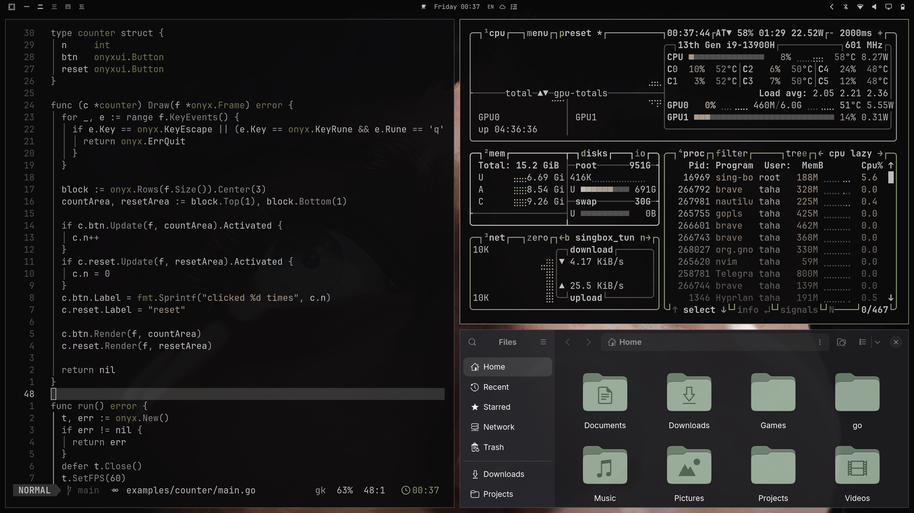

# Noir Dawn — Omarchy theme

A dark theme for the whole desktop. Soft black background (`#0c0b0c`), warm grey text,
muted sage accents.

Built for Omarchy Quattro

## Install

```bash
omarchy theme install https://github.com/tahadx/omarchy-noir-dawn-theme.git
```

## Editors

The theme styles the desktop; editors are set up separately. Each guide is
self-contained in `docs/`:

| Editor  | Guide                                        |
| ------- | -------------------------------------------- |
| Neovim  | [noir.nvim setup](docs/neovim.md)            |
| Zed     | [Noir Dawn theme](docs/zed.md)               |
| VS Code | [Noir Omarchy extension](docs/vscode.md)     |

## Preview



## Palette

| Role       | Hex       | Used for               |
| ---------- | --------- | ---------------------- |
| `bg`       | `#0c0b0c` | Background             |
| `alt_bg`   | `#1c1c1c` | Panels, hovers, status |
| `fg`       | `#c1c1c1` | Foreground             |
| `comment`  | `#505050` | Comments               |
| `constant` | `#aaaaaa` | Constants, numbers     |
| `func`     | `#888888` | Functions              |
| `keyword`  | `#999999` | Keywords, storage      |
| `operator` | `#9b99a3` | Operators, punctuation |
| `string`   | `#aa9988` | Strings                |
| `type`     | `#777755` | Types, classes         |
| `visual`   | `#333333` | Selection              |
| `accent`   | `#8a9a7b` | Accent, focus, tags    |

## Omarchy shell

`shell.toml` styles the Quickshell surfaces: bar, menus (`Super+K`
keybindings, clipboard, emojis), launcher, tooltips, popups, notifications,
lock, and polkit cards. Menus, launcher, and tooltips use the sage
active-border instead of Omarchy's default grey. It ships with the theme and
is picked up automatically on `omarchy theme set noir-dawn`.

## License

MIT
